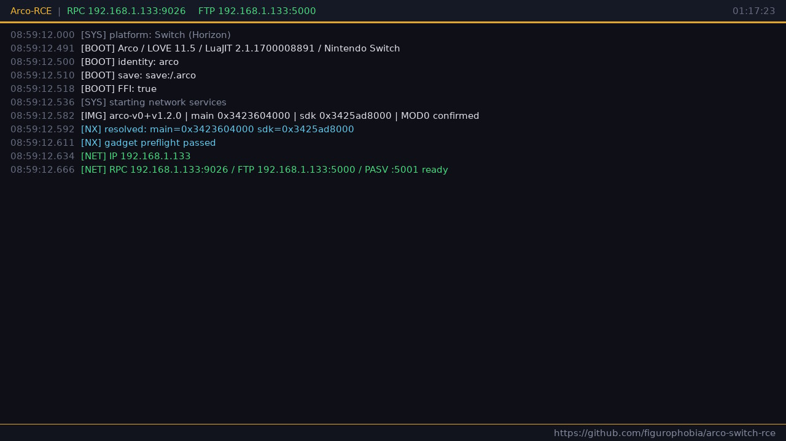

# Arco Switch RCE

Userland code execution on Nintendo Switch through Arco save data.

The save replaces the game's entry point with a networked Lua REPL and FTP server.
No cartridge modification, no romfs patches, no title update needed.
The exploit runs entirely in userland through the game's own LuaJIT runtime and SDK.



## What this is

**A proof of concept, not a product.** This is a research and instrumentation tool
that demonstrates save data exploitation in LÖVE engine games on Nintendo Switch.

- Verified on Switch 1 hardware (Arco v0 Base `0100E6601ACB6000` and v1.2.0
  Update `0100E6601ACB6800`). The update ships a byte-identical `main` and
  `sdk` NSO, so the same profile covers both builds
- Userland only, does not bypass DRM, does not modify game files
- Entirely based on [balatro-switch-rce](https://github.com/Luminger/balatro-switch-rce)
  by Luminger and [GravCirc-Switch-rce](https://github.com/figurophobia/GravCirc-Switch-rce),
  we adapted their JankFFI gadget chain and architecture for Arco

## Why this works

Arco is a [LÖVE](https://love2d.org/) game. LÖVE uses PhysFS to mount
directories into a virtual filesystem. When the game calls `love.filesystem.setIdentity()`
with `appendidentity = false`, the save directory is **prepended** to the search path.

This means any file placed in the save directory shadows the game's own version:

```
Search order:  save:/.arco/  →  game romfs
               ↑ our main.lua wins
```

Since `conf.lua` is loaded before the save is mounted, it cannot be shadowed — but
`main.lua` can, and that's all we need.

## What you get

- **Status console** — on-screen overlay showing boot log, resolved addresses, and service status
- **RPC** on TCP `9026` — networked Lua REPL (use `tools/rpc.py`)
- **FTP** on TCP `5000`/`5001` — read/write access to the LÖVE virtual filesystem
- **Savedata log** — `ar_log.txt` in the save directory
- **Native call support** — full-ABI AArch64 calls via JankFFI gadget chain

### Native call chain

On Switch, LuaJIT's `ffi.C` and `ffi.load` do not work (no `dlsym`).
Native SDK calls are dispatched through a gadget chain adapted from
[balatro-switch-rce](https://github.com/Luminger/balatro-switch-rce):

```
BC_FUNCC hijack → thunk → launder → fiber_switch → ctx_restore → capture gadget → fiber_switch back
```

Module bases are resolved at runtime:
- `jit.util.funcinfo(love.graphics.present).addr` anchors the main binary
- GOT memcpy entry resolves the SDK base
- Both confirmed via MOD0 magic bytes

All offsets are in `src/ar/offsets.lua` (SDK 16.2.8.0).

### Supported builds

| Game version | Title ID | Title version | `present` | `got_memcpy` | SDK module |
| --- | --- | --- | --- | --- | --- |
| v0 base | `0100E6601ACB6000` | v0 | `0x2cb800` | `0x550c18` | 16.2.8.0 |
| v1.2.0 update | `0100E6601ACB6800` | v327680 | `0x2cb800` | `0x550c18` | 16.2.8.0 (byte-identical NSO) |

Base and update share one profile. Arco's shipped nnSdk is byte-identical to
Balatro 1.0.1f's SDK — every JankFFI gadget signature matched at the same
offset Balatro recorded. The one difference is that Arco's dynamic linker
resolves the memcpy GOT entry straight to the real function body at
`sdk+0x5947c0`; the Balatro profile pointed to the preceding thunk at
`sdk+0x5947b0`, so `src/ar/offsets.lua` records `memcpy = 0x5947c0` for
Arco and the matching head bytes (`e80301cb0a0940925f0102eb62040054`).

### LuaJIT build defects

The Switch build of LuaJIT 2.1.0-beta3 has the same defects documented in
[balatro-switch-rce](https://github.com/Luminger/balatro-switch-rce):
`lj_vm_ffi_call` linked onto padding, broken 64-bit literals, broken cdata equality,
and fatal metatype Lua metamethods. The gadget chain works around all of these.

## Build

```sh
python3 build.py -o Arco-launcher.zip
```

This generates the JKSV metadata (`.nx_save_meta.bin`) and packs the full
archive — no exported save or account data needed. The ZIP is ready to
copy to `JKSV/Arco/` and restore.

## Install

The release ZIP is ready to import with JKSV, no extra steps needed:

1. Download the latest release ZIP (`Arco-launcher-v1.0.zip`). The same ZIP works on
   Arco **v0 base and v1.2.0 update**; the launcher picks the matching offset
   profile at boot
2. Copy it to `JKSV/Arco/` on the SD card
3. Open JKSV, select Arco, restore from the ZIP

⚠️ **The restore replaces the current Arco save.**

<details>
<summary>Building the ZIP yourself</summary>

```sh
python3 build.py -o Arco-launcher.zip
```

The script generates the JKSV metadata (`.nx_save_meta.bin`) automatically,
runs syntax checks, and packs everything into a ready-to-import archive.
No Switch, no exported save, no manual steps needed.

</details>

## Live use

```sh
# RPC — execute Lua on the console
python3 tools/rpc.py <console-ip> 'return 2+2'

# FTP — browse the virtual filesystem
curl --disable-epsv ftp://<console-ip>:5000/
curl --disable-epsv ftp://<console-ip>:5000/ar_log.txt
```

RPC and FTP are unauthenticated and unencrypted. Use on a trusted network only.

## Other LÖVE games

The save shadowing vulnerability affects any LÖVE game that uses `appendidentity = false`.
Confirmed working on Balatro and Gravity Circuit on Switch, plus Arco on PC
through the same `src/ar/socket_pc.lua` transport. The architecture is designed
to support multiple games through per-game offset tables in `offsets.lua`.

## Acknowledgements

This project is **heavily based on** [balatro-switch-rce](https://github.com/Luminger/balatro-switch-rce)
by [Luminger](https://github.com/Luminger) and [GravCirc-Switch-rce](https://github.com/figurophobia/GravCirc-Switch-rce).
The JankFFI dispatch chain, BC_FUNCC hijack technique, module resolution strategy,
FTP server, RPC protocol, and overall architecture were all developed by Luminger
for Balatro and extended by GravCirc. We adapted their work for Arco (same SDK
version 16.2.8.0 as Balatro, different main binary offsets, one memcpy GOT fix)
and confirmed that the same class of vulnerability exists in another LÖVE title
on Switch.

Without balatro-switch-rce and GravCirc-Switch-rce, this project would not exist.
Full credit to Luminger for the original research and implementation.

## Legal

This software is provided for educational and research purposes. Use of this software
may violate Nintendo's terms of service and can get a console banned.

## License

GPL-3.0 — see [LICENSE](LICENSE).
